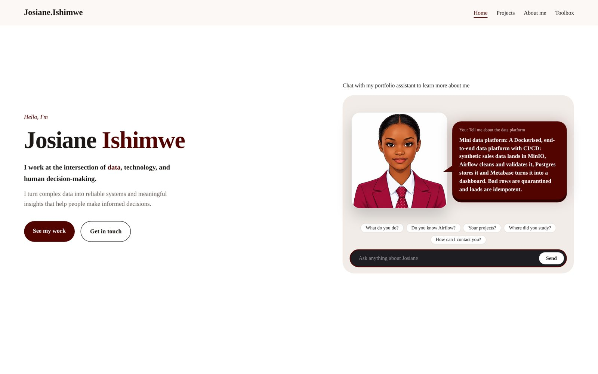
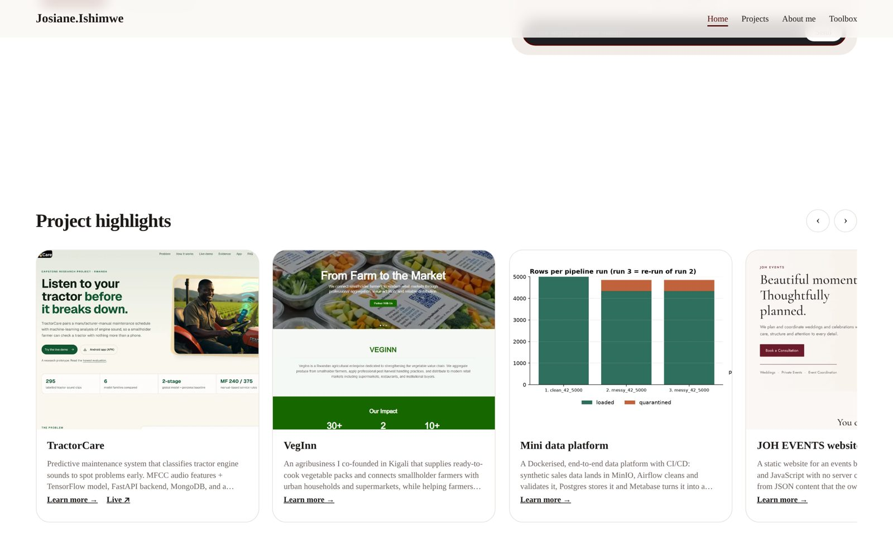
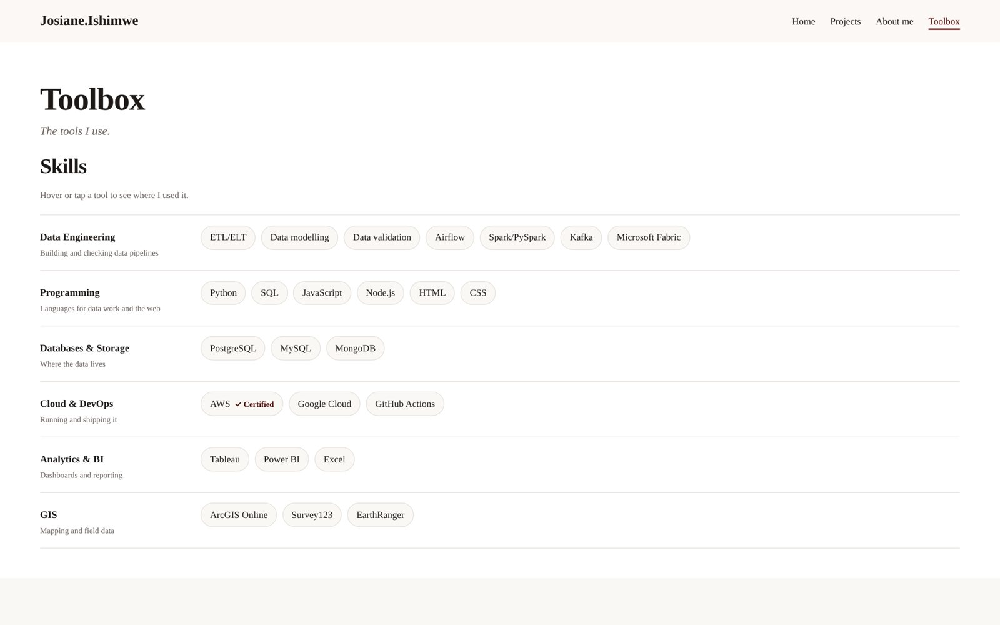
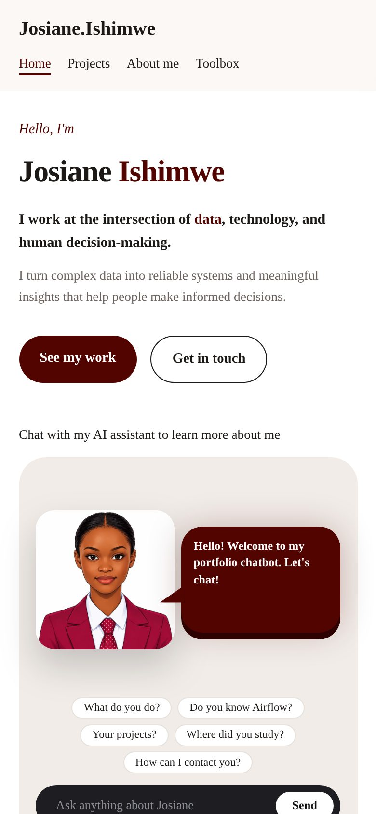

# Josiane Ishimwe: portfolio

Personal portfolio of a data engineer in Kigali, Rwanda. Plain HTML, CSS and
JavaScript: no framework, no build step, no dependencies.

**Live:** https://joh-ishimwe.github.io/my_portfolio/



## What's interesting about it

- **A chat assistant that needs no AI service.** "Ask Joh" answers questions
  about my skills, projects and experience with a small scoring engine
  ([`js/chat-engine.js`](js/chat-engine.js)): each topic has weighted trigger
  words and phrases, and the best-scoring topic answers. Answers are built
  from the same data as the rest of the site, so they cannot go out of date.
  It runs entirely in the browser, costs nothing and never invents an answer.
- **All content in one file.** Profile, skills, experience, projects and
  chat answers live in [`js/data.js`](js/data.js). The pages only render it.
  Content, logic and presentation are kept apart, the same separation of
  concerns I use in data pipelines.
- **Tested like a data product.** 100 automated tests (`npm test`, Node's
  built-in test runner, no packages) check that the chat gives the right
  answer to real questions, that every image and certificate path exists,
  and that the CV linked from the site is a real PDF.

| Project highlights | Toolbox | Mobile |
|---|---|---|
|  |  |  |

## Projects featured

| Project | What it shows |
|---|---|
| [TractorCare](https://github.com/Joh-Ishimwe/tractorcare-capstone) | ML capstone: engine-sound anomaly detection, with a leakage-aware evaluation |
| [Mini data platform](https://github.com/Joh-Ishimwe/mini-data-platform) | Airflow, Postgres, MinIO, Metabase, CI/CD; idempotent loads and a quarantine for bad rows |
| [VegInn](https://github.com/Joh-Ishimwe/VegInn) | Website for the agribusiness I co-founded: [veginn.rw](https://veginn.rw) |
| [JOH EVENTS](https://github.com/Joh-Ishimwe/JOH_EVENTS) | Content-managed static site with a resilient contact form |

## Run the tests

```bash
npm test        # node --test test/*.test.js
```

## Pages
| Page | What's on it |
|---|---|
| `index.html` | Hero, "Ask Joh" avatar chat, achievements carousel, project highlights |
| `about.html` | Photo, short bio, Download CV |
| `toolbox.html` | Skills, where I've worked, education |
| `impact.html` | Quote, story, numbers, impact areas with photo carousels |

## Structure
```
my_portfolio/
├── index.html, about.html, toolbox.html, impact.html
├── css/style.css     # look & feel — colour/font tokens at the top
├── js/data.js        # ★ ALL content: profile, skills, experience, projects, chat answers, impact
├── js/layout.js      # shared menu + footer for every page
├── js/main.js        # renders data.js into whichever page is open
└── assets/
    ├── images/avatar.webp          # avatar (transparent background)
    ├── images/achievements/        # optional achievement photos
    ├── images/impact/              # optional impact photos
    └── Josiane_Ishimwe_CV.pdf      # CV for the download button
```
Content (`data.js`), logic (`main.js`, `layout.js`) and presentation (`style.css`) are kept separate, the same separation of concerns used in data pipelines.

## Edit content
Open `js/data.js`. Photos go in `assets/images/…` and are referenced by path, e.g. `image: "assets/images/achievements/aws.jpg"`.

## Run locally
```bash
python -m http.server 8000   # then open http://localhost:8000
```
